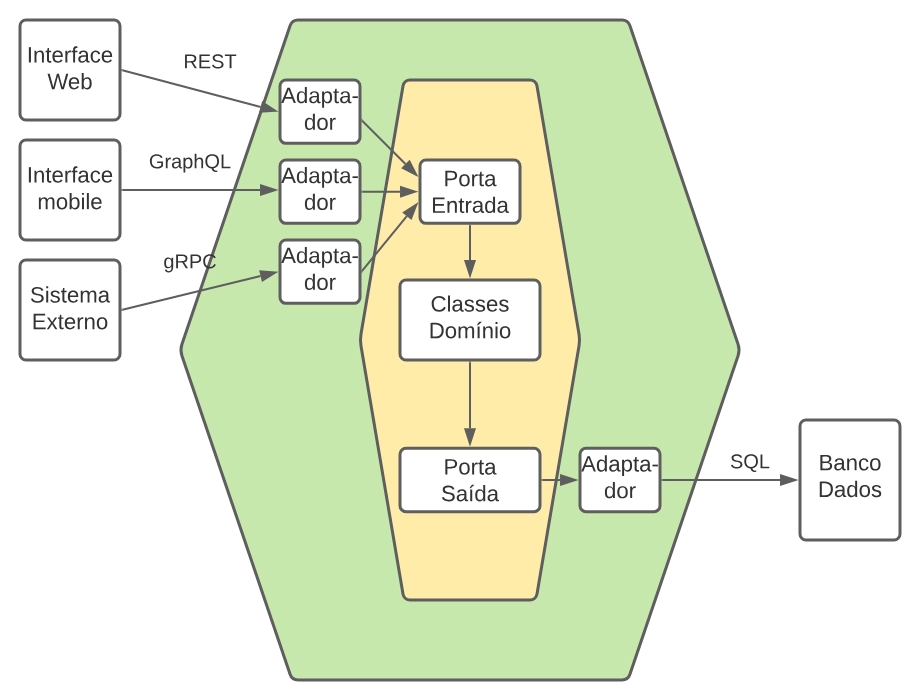

# Online Book Store

**Descrição:** Este projeto é uma aplicação web para uma livraria online, permitindo aos usuários navegar por livros, adicionar itens ao carrinho e realizar compras. Admin pode administrar o catálogo de livros, gerenciar pedidos e visualizar estatísticas de vendas.

## Tecnologias:

- Java (Spring Boot)
- MySQL Database
- Thymeleaf for Frontend
- Spring Security
- Hibernate ORM

## Arquitetura Hexagonal:

A arquitetura hexagonal é utilizada para separar a lógica de negócios do restante da aplicação, permitindo que a mesma seja testada e mantida de forma mais eficiente.

### Adapters and Ports:

- **Adapters:** Implementam as interfaces de entrada e saída da aplicação, como o controlador web, o repositório de dados, etc.
- **Ports:** Definem os contratos que os adaptadores devem implementar para se comunicar com a lógica de negócios.

  

